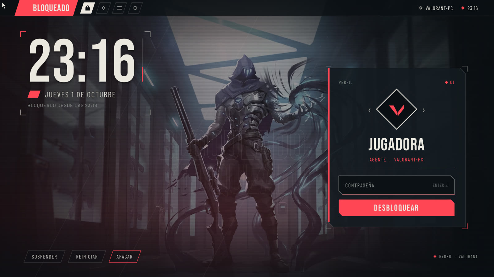
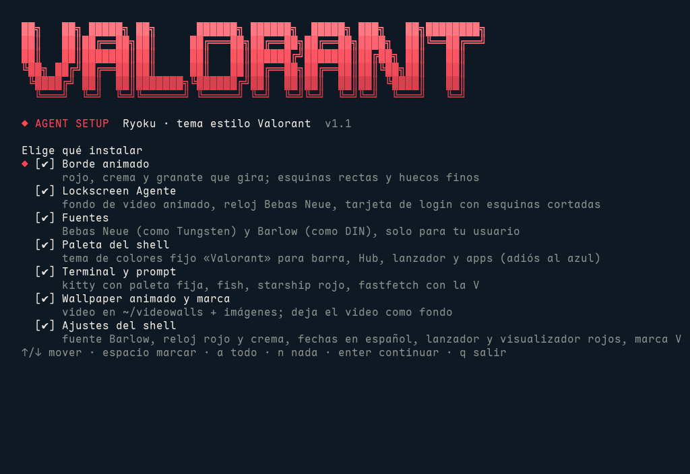
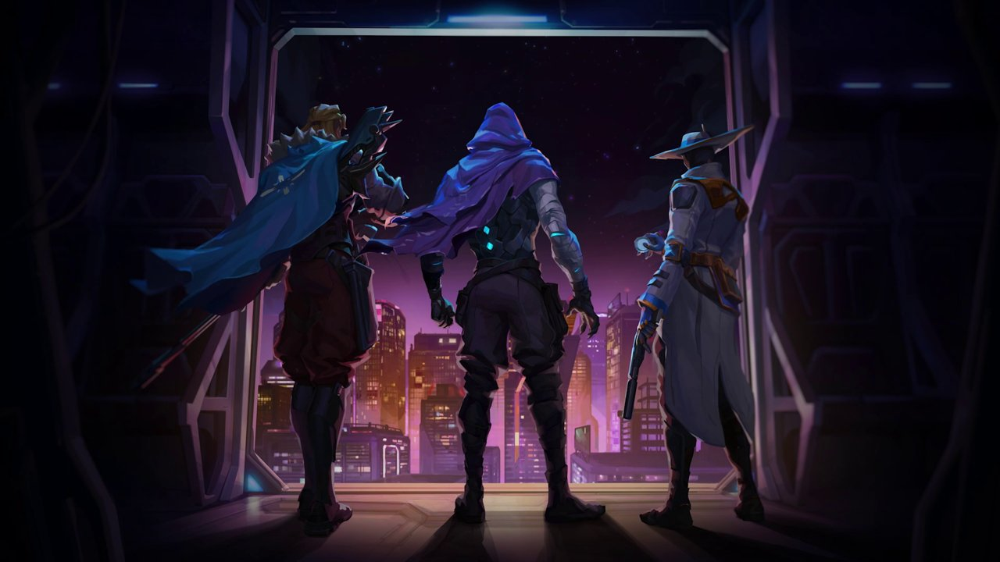

# ryoku-valorant-setup

Tema **estilo Valorant** para Ryoku (Arch Linux · Hyprland · Quickshell): paleta carbón + rojo + crema, sin azules, tipografías condensadas, esquinas cortadas y un solo instalador interactivo que respalda todo lo que reemplaza.

> Ryoku theme inspired by the Valorant client UI: charcoal/red/cream palette with no blue, Bebas Neue + Barlow type, sharp corners, an animated red/cream window border, a fixed shell colour scheme, an animated lockscreen and a looping video wallpaper. One interactive installer with backups, restore and uninstall. Unofficial fan theme, not affiliated with Riot Games.

## Vista previa

| Lockscreen (`Super + L`) | Instalador |
|---|---|
|  |  |



## Instalación

```bash
git clone <este-repo> ryoku-valorant-setup
cd ryoku-valorant-setup
./install.sh
```

Sin argumentos abre un menú con flechas: **Instalar**, **Simular** (no escribe nada), **Restaurar**, **Desinstalar** y **Salir**. Requiere Ryoku ya instalado y abierto al menos una vez, y `python3`.

| Componente | Qué hace | Dónde se ajusta después |
|---|---|---|
| `border` | Borde que gira en rojo, crema y granate; inactivo en grafito neutro; esquinas rectas y huecos finos (`~/.config/hypr/user.lua`) | `~/.config/hypr/user.lua`: se carga al final y gana a Hub → Window Manager (colores y giro del borde) |
| `lock` | Lockscreen «Agente»: fondo animado (video en bucle, con imagen fija de respaldo), reloj en Bebas Neue, tarjeta de login con esquinas cortadas | Hub → Lockscreen |
| `fonts` | Bebas Neue (parecida a Tungsten) y Barlow (parecida a DIN), solo en `~/.local/share/fonts` | — |
| `palette` | Tema de colores fijo **Valorant** para la barra, el Hub, el lanzador, las notificaciones y las apps que Ryoku tiñe. Fija la política de paleta de Ryogami en «Fixed palette» para que cambiar de wallpaper no vuelva al azul | Super+W → ajustes → Theme |
| `term` | kitty con paleta fija sin azul ni violeta, fish, starship (degradado crema→rojo), fastfetch con la V | `~/.config/kitty/user.conf` |
| `wall` | Video animado en `~/videowalls` + imágenes en `~/Pictures/Wallpapers`; deja el video como fondo | Super+W |
| `settings` | Fusiona solo las claves del tema en `shell.json`, `desktop.json`, `brand.json`, `widgets.json`, `launcher.json` y `visualizer.json` (ver abajo). No sustituye los archivos enteros | Reloj: clic derecho en el reloj → Customize (o `ryoku-shell hub open widgets`, que abre el editor de widgets del escritorio) · Hub → App Launcher · Hub → General → Regional formats |

Qué cambia `settings`:

- **Reloj del escritorio**: diseño «column» (horas sobre minutos, como los contadores del cliente), en Bebas Neue, horas y fecha en crema, minutos y día de la semana en el rojo de marca de Ryoku, sin tarjeta detrás. Ya no toma el azul del wallpaper.
- **Ventanas**: inactivo `#2a2c2e`, brillo rojo, velocidad del giro del borde, cursor Bibata Modern Classic (negro). El instalador vuelve a guardar `desktop.json` con el Hub para que Hyprland regenere su configuración.
- **Lanzador** (`Super + Space`): esquinas rectas y horizonte rojo fijo.
- **Visualizador de audio** (`Super + M`): degradado rojo → granate.
- **Shell**: fuente Barlow, esquinas rectas, marca V y cortina de recarga (el arte de Omen pasado a carbón y rojo).
- **Fechas en español**: `formatLocale` = `es_ES` (Hub → General → Regional formats), así el día de la semana y el mes del reloj salen en español. Solo cambia el formato de fechas y números del shell, no el idioma de la interfaz.

Flags para scripts: `--yes`, `--only border,lock` (o `--only=border,lock`), `--all`, `--dry-run`, `--list`, `--restore [dir]`, `--uninstall`.

## Pantalla de inicio de sesión

El instalador cambia el lockscreen de tu sesión (`Super + L`), pero **no** la pantalla de inicio de sesión (el greeter de SDDM), porque eso pide contraseña de administrador. Para llevar el mismo diseño, con su video, al greeter:

1. Abre **Hub → Lockscreen** (`Super + ,` y elige Lockscreen, o `ryoku-shell hub open lockscreen`).
2. Elige **valorant/agent** y aplícalo también a la pantalla de inicio de sesión. Te pedirá la contraseña.

## Atajos útiles

Todos se pueden cambiar en **Hub → Keybinds**. La última columna dice dónde se ajusta lo que abre cada atajo.

| Atajo | Qué hace | Dónde se cambia |
|---|---|---|
| `Super + Space` | Lanzador de apps | Hub → App Launcher |
| `Super + ,` | Ryoku Hub (ajustes) | — |
| `Super + L` | Bloquear la pantalla | Hub → Lockscreen; el tiempo hasta el bloqueo en Hub → Graphics & Power |
| `Super + W` | Selector de wallpapers y paleta | En el propio selector (ajustes → Theme) |
| `Super + Shift + W` | Wallpaper aleatorio | Selector `Super + W` |
| `Super + Return` | Terminal (kitty) | `~/.config/kitty/user.conf` |
| `Super + E` / `Super + B` | Archivos / navegador | Hub → Keybinds |
| `Super + Q` | Cerrar ventana | Hub → Keybinds |
| `Super + F` | Pantalla completa | Hub → Keybinds |
| `Super + A` | Ventana flotante o en mosaico | Hub → Keybinds |
| `Super + 1…0` | Ir al escritorio 1–10 | Hub → Keybinds |
| `Super + Shift + 1…0` | Mandar la ventana a otro escritorio sin seguirla | Hub → Keybinds |
| `Super + Tab` | Vista general | Hub → Keybinds |
| `Super + V` | Portapapeles | — |
| `Super + Shift + S` / `Impr` | Captura de pantalla | Hub → Keybinds |
| `Super + M` | Visualizador de audio | `Super + Alt + M` para colocarlo |
| `Super + K` | Hoja con todos los atajos | Hub → Keybinds |

## Deshacer

Cada instalación guarda en `~/.local/state/ryoku-valorant-backup/<fecha>-<id>/` lo que reemplazó, la lista de lo que creó (archivos y carpetas) y, aparte, la paleta, el wallpaper y el lockscreen que tenías antes. Cada ejecución tiene su propia carpeta, aunque lances dos en el mismo segundo, y una copia ya guardada nunca se sobrescribe. Volver a instalar cuando todo está igual no crea respaldo.

```bash
./install.sh --restore      # deshace la última instalación (o elige una en el menú)
./install.sh --uninstall    # deshace todas, de la más nueva a la más antigua
```

Cómo restaura:

- **Ajustes JSON** (`shell.json`, `desktop.json`, `brand.json`, `widgets.json`, `launcher.json`, `visualizer.json`, `ryogami.json`): solo vuelven a su valor anterior **las claves que puso el tema** (las de `settings/*.patch.json`, más `theme.theme`, que cambia la paleta). Una clave que no existía antes se borra. Lo demás que cambies en el Hub después de instalar se queda.
- **Resto de archivos** (kitty, fish, hypr, fuentes, lockscreen, wallpapers): se recupera el archivo entero y se borra lo que creó el instalador, con sus carpetas vacías. Si un archivo era un enlace simbólico (stow, chezmoi), el enlace se mantiene y se recupera el contenido al que apunta.
- **Paleta y wallpaper**: vuelve la paleta anterior del shell y el wallpaper anterior, si el archivo aún existe.
- Un respaldo ya restaurado pasa a `~/.local/state/ryoku-valorant-backup/.undone/`, así que un `--restore` o `--uninstall` posterior no lo vuelve a aplicar encima de tus cambios nuevos.
- No toca la pantalla de inicio de sesión: si la cambiaste, vuelve a elegir tu tema en Hub → Lockscreen.

## Paleta

| | |
|---|---|
| Fondo (carbón) | `#0b0f14` |
| Panel | `#141a21` |
| Rojo | `#ff4655` · granate `#bd3944` |
| Crema | `#ece8e1` |
| Apagado | `#8a8f8c` |
| Borde inactivo | `#2a2c2e` |

No hay cian ni azul en el borde, el reloj, la terminal ni la paleta del shell. En kitty, los huecos ANSI «azul», «magenta» y «cian» se cambian por rosa viejo, frambuesa y arena, así que `ls` y `git` tampoco pintan en azul ni violeta. El prompt y fastfetch usan solo rojo, crema, gris y el verde `#7bd88f` para lo que va bien.

## Limitaciones conocidas

- **Rojo del reloj**: los minutos usan el rojo de marca de Ryoku (`#e2342a`), no exactamente `#ff4655`; Ryoku no deja fijar un segundo color sin degradado. Si prefieres un degradado crema → rojo exacto: clic derecho en el reloj → Customize → Look → color «Gradient».
- **Paleta fija**: con el componente `palette` el shell deja de seguir los colores del wallpaper. Para volver a seguirlos: `Super + W` → ajustes → Theme → Palette behaviour → Follow wallpaper.
- **Modo claro**: el tema Valorant solo tiene variante oscura; Ryoku la usa también en modo claro.
- **Arte del juego**: las imágenes de Omen tienen luz azul propia. La cortina de recarga usa una versión pasada a carbón y rojo; la terminal la tapa con un tinte más fuerte; los wallpapers se quedan como son.
- **Claves del tema que cambies a mano**: si después de instalar cambias en el Hub una de las claves que puso el tema (por ejemplo el color del reloj), el restore la devuelve a lo que tenías antes del tema.
- **Respaldos de la v1.0**: no guardan qué claves cambió el tema, así que sus JSON se restauran enteros.
- **Video del lockscreen**: se decodifica una vez por monitor mientras la pantalla está bloqueada; en equipos con poca GPU puede notarse.
- **Apps GTK/libadwaita**: su color de acento lo decide Ryoku a partir de la paleta; el instalador no lo cambia a mano.

## Créditos y licencias

- Fuentes [Bebas Neue](https://github.com/dharmatype/Bebas-Neue) y [Barlow](https://github.com/jpt/barlow): SIL Open Font License (ver `files/.local/share/fonts/valorant/OFL-*.txt`).
- La V del emblema es un dibujo propio inspirado en el logo del juego.
- El video y las imágenes de fondo son arte del juego (© Riot Games) aportados por la usuaria para uso personal. **No publiques este repo si no tienes derecho a redistribuirlos**; quita `files/videowalls/`, `files/.local/share/qylock/themes/valorant/agent/background.mp4` y los `valorant-*.png` antes de hacerlo.
